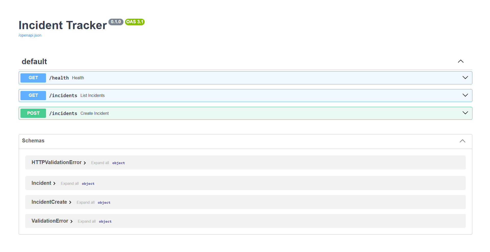

# Incident Tracker

FastAPI + PostgreSQL incident API (work in progress).

## Run locally
```bash
python3 -m venv .venv
source .venv/bin/activate
pip install -r requirements.txt
uvicorn app.main:app --reload
```
Docs page: http://127.0.0.1:8000/docs



## Running tests

The tests use a separate PostgreSQL database so your real data is never touched.

### One-time setup

1. Create the test database (the name must end in `_test`):

   ```bash
   sudo -u postgres psql -c "CREATE DATABASE incident_tracker_test OWNER incident_app;"
   ```

2. Create and activate a virtual environment, then install dependencies:

   ```bash
   python3 -m venv .venv
   source .venv/bin/activate
   pip install -r requirements.txt
   ```

### Each new terminal

```bash
source .venv/bin/activate
export TEST_DATABASE_URL="postgresql+psycopg2://incident_app:<your-password>@localhost:5432/incident_tracker_test"
```

Replace `<your-password>` with your own. Never commit it.

### Run

From the repository root:

```bash
python -m pytest tests/ -v
```

### Notes

- Each test starts with fresh, empty tables. The fixture in `tests/conftest.py` drops and recreates them, then inserts one service (`id 1`).
- `conftest.py` refuses to run if the database name does not end in `_test`.
- Run pytest from the repo root. Running it from inside `tests/` causes `ModuleNotFoundError: No module named 'app'`.


## Image sizes

All sizes were measured with `docker images` on the same machine. The base image is `python:3.14-slim` in every row.

| Image | Disk usage | Content size (compressed) |
|---|---|---|
| `incident-tracker:single` (single-stage, `pip --no-cache-dir`) | 361 MB | 84.8 MB |
| `incident-tracker:multi` (multi-stage, `pip --no-cache-dir`) | 346 MB | 81.1 MB |
| *Experiment:* single-stage **without** `--no-cache-dir` | 427 MB | 116 MB |

**What this shows**
- Multi-stage vs single-stage with `--no-cache-dir`: 15 MB smaller on disk (about 4%). The saving is small because pip's cache was already disabled and the dependencies need no compilers.
- Multi-stage vs single-stage without `--no-cache-dir`: 81 MB smaller on disk (about 19%) and 34.9 MB smaller compressed (about 30%). The pip cache stays in a single-stage image, but it is left behind in the discarded build stage of a multi-stage one.
- Takeaway: multi-stage keeps build leftovers out of the shipped image without needing to remember each cleanup flag.

*Disk usage is the uncompressed size of all layers. Content size is the compressed size, roughly what a registry transfers.*