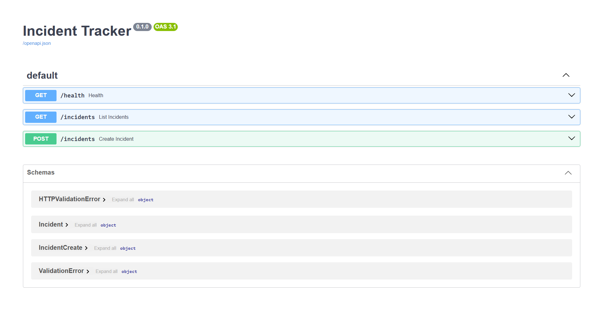

# Incident Tracker

FastAPI + PostgreSQL incident API (work in progress).

## Run locally
```bash
python3 -m venv .venv
source .venv/bin/activate
pip install -r requirements.txt
uvicorn app.main:app --reload
```
Docs page: http://127.0.0.1:8000/docs

